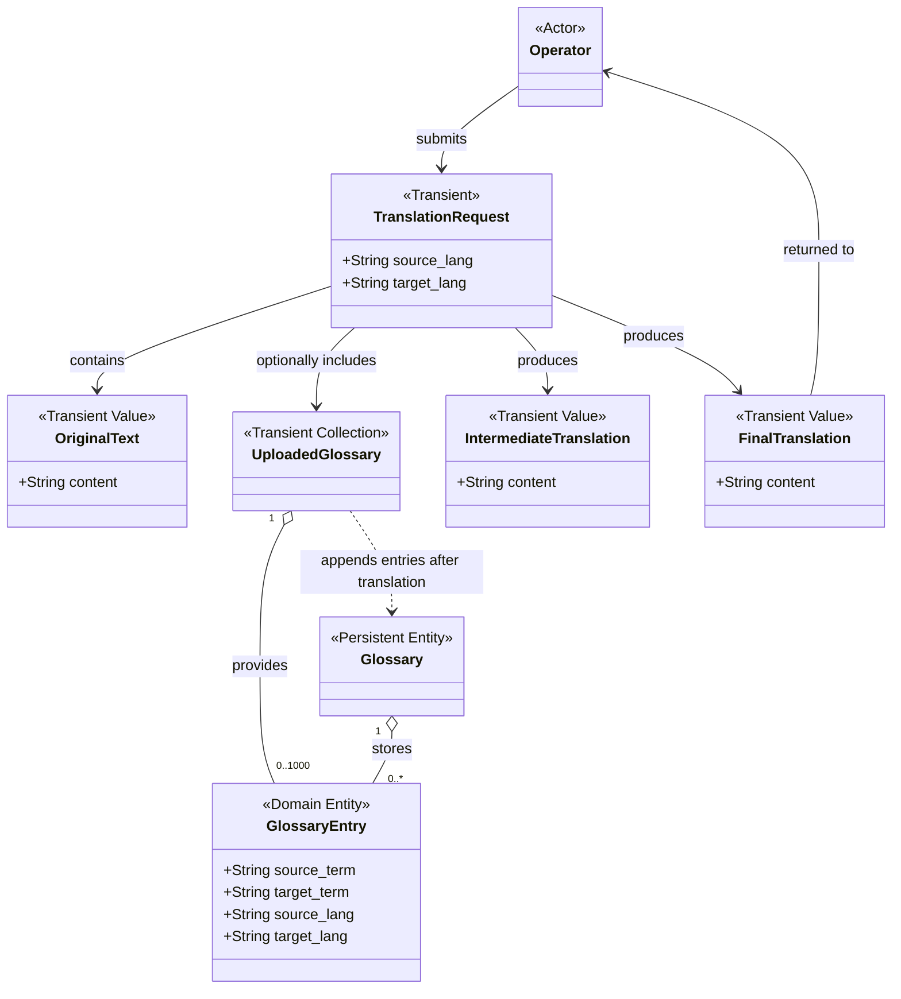

# GMS v4 — Entity Model

**Status:** Draft
**Version:** 0.3
**Methodology:** AI Unified Process / Spec-Driven Development

## 1. Domain Overview

GMS v4 is a glossary-aware translation web application.

The application translates original text through two sequential stages:

1. Glossary-aware machine translation using DeepL.
2. Glossary-aware post-editing using a GPT model.

For each Translation Request, only the Glossary Entries
provided in the current upload are used for translation.

After translation, the uploaded Glossary Entries are appended
to the persistent Glossary.

Previously stored Glossary Entries are not retrieved or
used during the current translation process.

### Domain Classification

**External Actor**

- Operator

**Persistent Domain Entities**

- Glossary
- Glossary Entry

**Transient Domain Concepts**

- Translation Request
- Uploaded Glossary
- Original Text
- Intermediate Translation
- Final Translation

Only Glossary data is stored persistently.

---

## 2. Domain Model

---

## 3. Persistent Domain Entities

### 3.1 Glossary

A Glossary is a single, cumulative collection of
terminology mappings.

The Glossary is primarily intended for medical
translation terminology.

There is one logical Glossary in the application.

The Glossary contains persistently stored Glossary Entries.

New Glossary Entries are appended after translation
without replacing previously stored entries.

The persistent Glossary is not used as the terminology
source for the current Translation Request.

The database structure and internal identifiers
are not defined at this stage.

### 3.2 Glossary Entry

A Glossary Entry represents a terminology mapping
between a source-language term and its required
target-language equivalent.

Each Glossary Entry contains exactly four canonical fields.

| Attribute | Type | Description | Required |
|---|---|---|---|
| source_term | String | Term in the source language | Yes |
| target_term | String | Required equivalent in the target language | Yes |
| source_lang | String | Language of the source term | Yes |
| target_lang | String | Language of the target term | Yes |

No additional canonical fields are defined.

Glossary Entries may initially exist as transient
data provided by an Uploaded Glossary.

After translation, the uploaded entries are appended
to the persistent Glossary.

---

## 4. Transient Domain Concepts

### 4.1 Translation Request

A Translation Request represents an instruction
to translate Original Text from a source language
into a target language.

| Attribute | Type | Description | Required |
|---|---|---|---|
| source_lang | String | Language of the Original Text | Yes |
| target_lang | String | Desired translation language | Yes |

Relationships:

- Contains one Original Text.
- May include one Uploaded Glossary.
- Produces one Intermediate Translation during successful processing.
- Produces one Final Translation during successful processing.

A Translation Request is not stored persistently.

### 4.2 Original Text

Original Text is the source content submitted
by the Operator for translation.

| Attribute | Type | Description | Required |
|---|---|---|---|
| content | String | Original text to be translated | Yes |

Original Text exists temporarily during the
translation process.

It is not stored in the application database.

### 4.3 Uploaded Glossary

An Uploaded Glossary is a temporary collection
of at most 1,000 Glossary Entries supplied by
the Operator for the current Translation Request.

The Uploaded Glossary is provided as a JSON file.

It contains zero to 1,000 Glossary Entries in
total, including entries from mixed language pairs.

This cardinality limit applies only to one uploaded
JSON array. It does not limit the cumulative persistent
Glossary collection.

An Uploaded Glossary is represented as a JSON array
of Glossary Entry objects.

Each object contains exactly the four canonical
Glossary Entry fields.

Only entries from this Uploaded Glossary
are used for terminology alignment during
the current translation process.

The persistent Glossary database is not queried
to obtain additional terminology for translation.

After translation, the uploaded entries
are appended to the persistent Glossary.

The Uploaded Glossary itself is not stored
as a separate persistent collection.

### 4.4 Intermediate Translation

Intermediate Translation is the translated text
generated by DeepL during the first translation stage.

| Attribute | Type | Description | Required |
|---|---|---|---|
| content | String | Machine-translated text | Yes |

Intermediate Translation is generated using:

- Original Text
- Source and target languages
- Applicable Glossary Entries from the Uploaded Glossary

It is subsequently used as an input for
LLM post-editing.

Intermediate Translation is not stored
in the application database.

### 4.5 Final Translation

Final Translation is the translated text produced
by the GPT model after post-editing the
Intermediate Translation.

| Attribute | Type | Description | Required |
|---|---|---|---|
| content | String | Final translated text | Yes |

Final Translation is produced using:

- Original Text
- Intermediate Translation
- Applicable Glossary Entries from the Uploaded Glossary

Final Translation is returned to the Operator.

It can be displayed in the browser and
downloaded as a TXT file.

Final Translation is not stored
in the application database.

---

## 5. External Actor

### Operator

The Operator is a human who interacts with
the application through a web browser.

The Operator can:

- Enter Original Text.
- Specify source and target languages.
- Upload a JSON Glossary.
- Submit a Translation Request.
- View the Final Translation.
- Download the Final Translation as a TXT file.

The Operator is an external Actor,
not a persistent domain entity.

No User entity is defined.

---

## 6. Domain Rules

### DR-001 — Single Persistent Glossary

The application maintains one logical,
cumulative Glossary.

### DR-002 — Canonical Glossary Entry

Each Glossary Entry contains exactly four
canonical fields:

- source_term
- target_term
- source_lang
- target_lang

### DR-003 — Current-Request Glossary Usage

Only Glossary Entries provided in the current
Uploaded Glossary are used for translation.

Previously stored Glossary Entries are not
used during the current Translation Request.

### DR-004 — Two-Stage Translation

Translation follows two sequential stages:

1. DeepL produces the Intermediate Translation.
2. GPT produces the Final Translation through post-editing.

Both stages use applicable entries from the
current Uploaded Glossary.

### DR-005 — Glossary Accumulation

After both translation stages complete successfully,
Glossary Entries from the current Uploaded Glossary
are appended to the persistent Glossary.

The required append operation must complete
successfully before the Final Translation is
returned to the Operator.

Previously stored entries are not replaced or deleted.

If persistence fails, the Translation Request
is treated as unsuccessful.

### DR-006 — Transient Translation Data

Original Text, Intermediate Translation,
Final Translation, and Translation Requests
are not stored persistently in the
application database.

### DR-007 — No User Entity

The application does not maintain
registered user accounts.

The Operator exists only as an external Actor.
